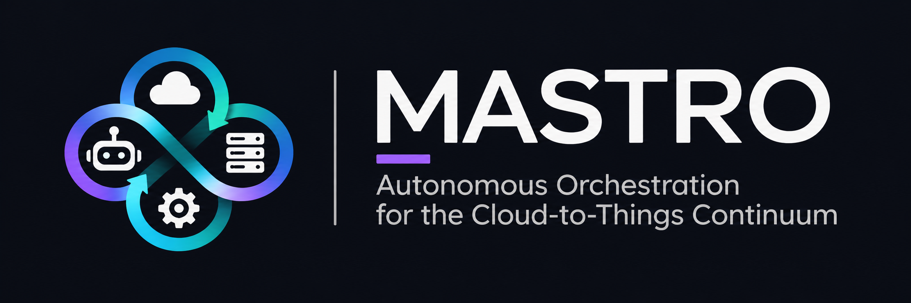

# MASTRO

**Multi-Agent Autonomous System for Task and Resource Orchestration in the Cloud-to-Things Continuum.**



MASTRO is an agentic framework in which LLM-based agents close the control loop of resource
orchestration: they monitor infrastructure, diagnose anomalies, act through MCP tools and verify
the effects of their actions, in response to operator requests or autonomously.

The agentic core is independent of the managed orchestrator. A replaceable integration package,
[`orchestrator/`](orchestrator/), supplies infrastructure tools, discovery, domain skills and
configuration. The bundled implementation demonstrates MASTRO with
[MOSAIC](https://github.com/marcopettorali/MOSAIC) in a distributed edge/fog/cloud testbed.

## Architecture

- **Intent Module**: routes natural-language requests to agents and streams their reasoning and answers.
- **Decision Engine**: skill loading, prompt construction, OpenAI-compatible LLM adapter, memory,
  ReAct reasoning and MCP tool dispatch.
- **Agent Scheduler**: periodic autonomous runs with structured verdicts (`ok`, `warning`, `critical`).
- **Operational context and notifications**: maintenance windows, energy forecasts and operator
  directives inform the agents; notifications report conditions requiring attention.
- **MCP Gateway**: generic Streamable HTTP/stdio transport hosting the active adapter's tools
  and MASTRO gateway lifecycle tools.
- **Orchestrator adapter**: contains the implementation and procedures for a particular infrastructure.
- **GUI and CLI**: chat, context, agent configuration, skills, gateway management and operational access.
- **Persistence**: optional MongoDB storage, with in-memory operation when MongoDB is not configured.

## Requirements

- Python 3.11 or later, Node.js 18 or later, npm.
- An LLM endpoint compatible with the OpenAI API.
- A running infrastructure supported by the selected adapter, or its mock mode for development.
- MongoDB, optionally, for persistent sessions, notifications and operational context.

## Installation and startup

```bash
./scripts/install.sh
./scripts/start.sh
```

Installation creates a Python virtual environment, installs the adapter and frontend dependencies,
and initializes `config/` without overwriting existing settings. Infrastructure setup is described
in the selected adapter's documentation.

| Component | Default address |
|-----------|-----------------|
| Frontend | `http://localhost:5174` |
| Backend | `http://localhost:9100` |
| MCP Gateway, when started | `http://localhost:8001/mcp` |

1. Configure the LLM endpoint in **Settings → LLM Settings**.
2. Customize agents, skills and autonomous mode in **Settings → Agents & Skills**.
3. Start the **MCP Gateway** in mock mode or against the managed infrastructure.
4. Use **Chat** for intents and **Context** for operational facts.

Agents can also connect to external MCP servers through their `mcp_servers` configuration.

## Replacing the orchestrator

Replace `orchestrator/` with another package implementing the
[adapter contract](docs/adapter-contract.md), reinstall the adapter and restart MASTRO.
Backend, agent engine, gateway transport, GUI and platform CLI commands remain unchanged.
The replacement supplies its own API clients, MCP tools, node discovery, CLI infrastructure
commands, skills and initial agent profiles.

`ORCHESTRATOR_URL` selects the managed infrastructure endpoint. `MASTRO_URL` selects the platform
endpoint used by the gateway's management tools. `MOCK_MODE` and `DRY_RUN` select adapter mock
and dry-run behavior; `MASTRO_MCP_TOOLS` can limit the adapter's tool modules. Adapter-specific
settings are documented within `orchestrator/`.

When switching an existing installation, review `config/agents.json`: operator-defined agent
profiles are preserved, so old skill names, MCP endpoints and prompts may need updating.

## CLI

```bash
./scripts/install_cli.sh
mastro agent list
mastro intent "Summarize the infrastructure state" --agent <agent_id>
mastro --help
```

Platform commands go to MASTRO; infrastructure commands are contributed by the adapter.
See the [CLI documentation](cli/README.md).

## Use case: distributed orchestration with MOSAIC

The bundled adapter connects to MOSAIC's orchestrator and distributed runtimes. It exposes
monitoring, placement, job inspection, deployment and traffic generation as MCP tools. Its
skills describe operational procedures for an edge/fog/cloud deployment.

The use case includes voice and video pipelines, datasets and an IntentContinuum-style baseline
under `orchestrator/`. See the [use-case setup and examples](orchestrator/README.md) for the
infrastructure requirements, environment variables and experimental applications.

## Repository layout

| Path | Content |
|------|---------|
| `backend/` | Platform API, agent engine, scheduler, context and notifications |
| `frontend/` | React interface |
| `mcp_gateway/` | Generic MCP transport and platform gateway management tools |
| `orchestrator/` | Replaceable infrastructure integration, including clients, tools, skills and examples |
| `cli/` | Platform CLI with adapter-provided infrastructure commands |
| `docs/adapter-contract.md` | Contract for replacement adapters |
| `scripts/` | Installation and startup |
| `config/` | Local runtime settings, excluded from Git |

## License

MASTRO is released under the [GNU General Public License v3.0](LICENSE).
